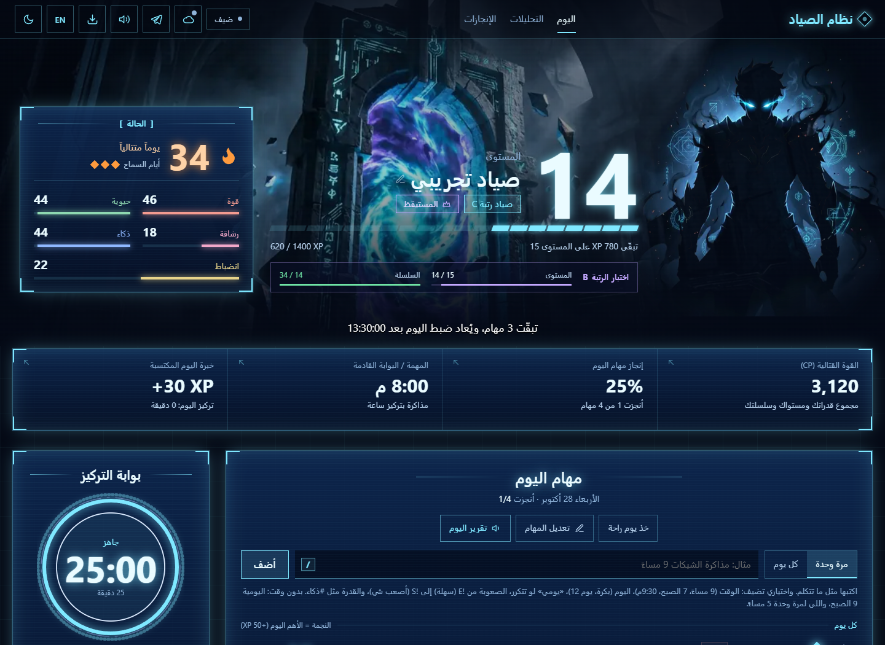
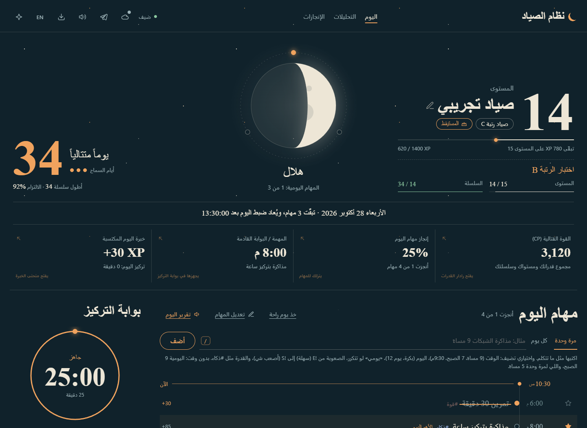

<div align="center">

# نظام الصياد · Hunter System

**حوّل مهامك اليومية إلى رحلة تقدّم: مهام، خبرة، رتب، وسلسلة إنجاز.**

[افتح الموقع](https://fadel-xr7.github.io/hunter-system/) · [مساعد تيليجرام](https://t.me/Hunters_system_bot) · [بلّغ عن مشكلة](https://github.com/Fadel-xr7/hunter-system/issues/new)

[](https://github.com/Fadel-xr7/hunter-system/actions/workflows/test.yml)

[](LICENSE)

Arabic / English · واجهتا أنمي وحبر الليل · قابل للتثبيت كتطبيق ويب

</div>

## ابدأ خلال دقيقة

1. افتح [نظام الصياد](https://fadel-xr7.github.io/hunter-system/).
2. أنشئ حسابًا للمزامنة بين أجهزتك، أو اختر «كمّل كضيف» للاستخدام على نفس المتصفح.
3. أضف مهمة، اختر وقتها، وابدأ الإنجاز. اليومية بدون وقت تبدأ افتراضيًا الساعة 9 صباحًا، والمهمة لمرة واحدة الساعة 5 مساءً.
4. نزّل نسخة احتياطية من قائمة النسخ الاحتياطي، خصوصًا عند استخدام وضع الضيف.

المشروع متاح للاستخدام التجريبي؛ قد تتغير الواجهة والميزات مع التحديثات.

## الواجهتان

### واجهة الأنمي



### حبر الليل



الصور من نسخة محلية ببيانات وهمية، وليست بيانات حساب حقيقي.

## ماذا يقدم؟

- **مهام يومية وبوابات لمرة واحدة:** أوقات، أيام تكرار، صعوبات، وخطوات فرعية.
- **خبرة ورتب وقدرات:** تقدّم مرئي مع الإنجاز، وسلسلة أيام مع أيام سماح وراحة.
- **مؤقت تركيز:** جلسات مرتبطة بمهمة، ومكافآت للتقدّم.
- **تقارير وتحليلات:** ملخصات، سجل الإنجاز، وإحصاءات الخبرة والقدرات.
- **لغتان وواجهتان:** العربية والإنجليزية، وتصميما أنمي وحبر الليل.
- **حساب ومزامنة:** متابعة المهام بين الجوال والكمبيوتر.
- **نسخ احتياطي:** تصدير واستيراد، وحفظ نسخة عند معالجة تعارض البيانات.
- **مساعد تيليجرام:** دردشة طبيعية وتجهيز مهمة بطلب صريح، مع التأكيد داخل الموقع.

## مساعد تيليجرام

افتح [@Hunters_system_bot](https://t.me/Hunters_system_bot) وجرّب:

- `هلا، شلونك؟` — دردشة عادية، بدون إنشاء مهمة.
- `ضيف مهمة أذاكر بكرة 5 العصر` — ملخص بتاريخ محدد والساعة 17:00، وزر يفتح الموقع.
- `ضيف مهمة` — يسألك عن التفاصيل الناقصة.
- `إلغاء` أو `/cancel` — يلغي الطلب المعلّق.

**المهمة تُضاف بعد تأكيدك في الموقع.** البوت لا يقرأ حسابك أو يضيف إليه مباشرة. إذا تعذّر فهم تكملة طلب، يطلب كتابة المهمة كاملة برسالة واحدة بدل تجهيز رابط غير موثوق.

رسائل المساعد وبعض سياق المحادثة تُرسل إلى **Groq** للفهم والرد. الذاكرة مؤقتة وقد تُفقد عند إعادة تشغيل الدالة أو انتقال الطلب إلى نسخة أخرى منها. توجد حدود للاستخدام، وقد يتعذّر الذكاء عند بلوغها.

## البيانات والخصوصية

- وضع الضيف يحفظ البيانات على نفس المتصفح. مسح بيانات الموقع قد يزيلها، لذلك احتفظ بنسخة احتياطية.
- الحسابات تستخدم Supabase للمصادقة والمزامنة، وقواعد الوصول تربط كل صف بصاحبه.
- عند وجود تعديلات غير متزامنة مرتبطة بحساب، يمنع الموقع فتحها كضيف أو رفعها لحساب آخر حتى يدخل صاحبها.
- لا ترفق كلمات مرور أو مفاتيح API أو ملفات نسخ احتياطية شخصية عند الإبلاغ عن مشكلة.
- مفتاح Supabase الظاهر في الواجهة مفتاح عام؛ المفاتيح السرية ومفتاح Groq وتوكن تيليجرام تبقى في إعدادات الخادم.

## للمطوّر

هذه التعليمات لصاحب المشروع أو لمن حصل على إذن مناسب؛ الاطلاع على المستودع لا يمنح رخصة لإعادة استخدامه. راجع [حقوق الاستخدام](LICENSE).

الموقع مبني بـ HTML وCSS وJavaScript، بدون خطوة بناء. التشغيل المحلي، من جذر المشروع:

```sh
python -m http.server 5500 --bind 127.0.0.1 --directory docs
```

ثم افتح [http://127.0.0.1:5500/](http://127.0.0.1:5500/). استخدم بيانات تجربة؛ الإعدادات الافتراضية تشير إلى الخدمة المنشورة.

### الفحوصات

يتطلب تشغيل اختبارات المنطق Node.js 22.6 أو أحدث:

```sh
npm test
npm run check
```

لاختبارات المتصفح، ثبّت تبعيات التطوير والمتصفح أولًا:

```sh
npm ci
npx playwright install chromium
npm run test:e2e
```

اختبارات المتصفح تستخدم بيانات وخدمات وهمية. تقييم Groq الحقيقي منفصل في `scripts/groq-dialect-eval.ts` ويحتاج مفتاحًا في بيئة التشغيل؛ لا تضع المفتاح في ملف متتبع أو في بلاغ عام.

### خريطة الملفات

| المسار | المحتوى |
| --- | --- |
| `docs/` | الموقع الذي ينشره GitHub Pages |
| `docs/js/` | منطق المهام والواجهة والمزامنة |
| `supabase/setup.sql` | إعداد الجدول وقواعد الوصول |
| `supabase/functions/telegram-bot/` | المساعد وإدارة رسائل تيليجرام |
| `tests/` | اختبارات المنطق وملفات الموقع والبوت |
| `tests/e2e/` | اختبارات المتصفح |
| `scripts/` | أدوات التقييم |
| `.github/workflows/test.yml` | الفحوصات الآلية على GitHub |

## الملاحظات والاقتراحات

افتح [بلاغًا أو اقتراحًا](https://github.com/Fadel-xr7/hunter-system/issues/new) مع وصف ما حدث والخطوات التي تكرره والجهاز أو المتصفح المستخدم. استخدم بيانات وهمية في الصور.

للطلبات المتعلقة بإعادة استخدام الكود أو الأصول، افتح طلب إذن من نفس الرابط. الإبلاغ عن خطأ لا يعني منح ترخيص لإعادة الاستخدام أو الموافقة على أي مساهمة برمجية.

## الحقوق

© 2026 [Fadel-xr7](https://github.com/Fadel-xr7). **جميع الحقوق محفوظة** في المواد الأصلية التي يملك حقوقها، بالقدر الذي يحميه القانون.

المستودع متاح للاطلاع، وليس مرخّصًا كمشروع مفتوح المصدر. تبقى الحقوق المقررة قانونًا وشروط GitHub، ومنها المشاهدة وعمل Fork داخل GitHub، سارية. التفاصيل في [LICENSE](LICENSE)، وتراخيص المكتبات والخطوط في [THIRD_PARTY_NOTICES.md](THIRD_PARTY_NOTICES.md).

مشروع مستقل مستوحى من أجواء ألعاب تقمّص الأدوار، وليس منتجًا رسميًا تابعًا لـ Solo Leveling.

---

**English:** Hunter System is an Arabic/English task and habit tracker with XP, ranks, focus sessions, cloud sync, and a Telegram assistant. [Try the live app](https://fadel-xr7.github.io/hunter-system/). The original project materials are all rights reserved; third-party components retain their own licenses.
